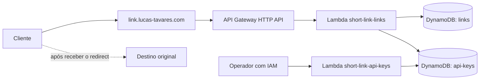

# short-link

Encurtador de links com backend Node.js, duas funções AWS Lambda e DynamoDB. O endereço público será `https://link.lucas-tavares.com`.

Este README define o projeto antes da implementação. Os recursos AWS, as funções e os comandos de aplicação descritos abaixo ainda não foram criados nem publicados. Os exemplos representam o contrato a implementar.

## Requisitos

- Apenas backend, sem interface web.
- Leitura pública: qualquer pessoa com o link pode acessar o redirecionamento, sem API key ou login.
- Criação de links autenticada pelo header `x-api-key`.
- Códigos de exatamente seis letras minúsculas, de `a` a `z`, sem números. Exemplo: `https://link.lucas-tavares.com/abcdef`.
- A mesma URL deve retornar o código existente, inclusive quando os pedidos forem simultâneos ou usarem API keys diferentes.
- Exatamente duas Lambdas: uma para criar e resolver links; outra para criar, listar e excluir API keys.
- Administração das API keys exclusivamente por invocação direta da Lambda, autorizada por IAM. Sem endpoint HTTP para essa administração.
- Infraestrutura Terraform seguindo o modelo do projeto `../web-streaming`.

## Arquitetura



O Route 53 resolve o domínio para o domínio personalizado regional do API Gateway, com HTTPS e certificado ACM. O DNS não autentica requisições. O API Gateway encaminha apenas as rotas públicas de resolução e a rota de criação para a Lambda de links.

A Lambda administrativa não terá integração com API Gateway, Function URL ou permissão pública de invocação. Sua autorização será a permissão IAM `lambda:InvokeFunction` do operador, via AWS CLI ou SDK. A API key do encurtador não concede essa permissão administrativa.

## Redirecionamento

Ao acessar um código existente, o encurtador retorna `302 Found` com a URL original no header `Location`. O cliente segue esse endereço e acessa o destino diretamente.

A responsabilidade do encurtador é armazenar a associação entre URL e código e retornar o redirecionamento. A URL original será preservada exatamente, incluindo query string e ordem dos parâmetros. Não serão acrescentados parâmetros da requisição ao endereço curto. A resposta usará `Cache-Control: no-store`.

## API HTTP

Base: `https://link.lucas-tavares.com`.

| Método e rota  | Autenticação | Comportamento                                            |
| -------------- | ------------ | -------------------------------------------------------- |
| `POST /links`  | `x-api-key`  | Cria um código ou retorna o código já associado à URL.   |
| `GET /{code}`  | Pública      | Retorna `302 Found` para a URL original.                 |
| `HEAD /{code}` | Pública      | Retorna o mesmo status e os headers do `GET`, sem corpo. |

Não haverá endpoints HTTP para gerenciar API keys. Listar, editar e excluir links não fazem parte desta versão.

### Criar ou recuperar um link

```http
POST /links HTTP/1.1
Host: link.lucas-tavares.com
Content-Type: application/json
x-api-key: <API_KEY>

{
  "url": "https://example.com/recurso?parametro=valor"
}
```

Uma nova associação retorna `201 Created`:

```json
{
  "code": "abcdef",
  "shortUrl": "https://link.lucas-tavares.com/abcdef",
  "created": true
}
```

Uma associação existente retorna `200 OK`, com o mesmo `code` e `shortUrl`, e `created: false`. Repetições também exigem API key válida. A deduplicação é global; não é separada por chave.

O campo `url` deve ser uma string de URL absoluta HTTP ou HTTPS, com no máximo 8 KiB em UTF-8. Não serão aceitos espaços literais, caracteres de controle, credenciais embutidas (`usuario:senha@host`) nem o próprio domínio do encurtador como destino. Não haverá consulta ao destino para testar disponibilidade.

URLs serão comparadas pelo texto exato enviado, sem normalização, remoção de fragmentos, decodificação ou reordenação dos parâmetros. Assim, `https://example.com/a?x=1&y=2` e `https://example.com/a?y=2&x=1` são URLs diferentes. Essa regra preserva o texto exato da URL recebida.

### Resolver um link

```http
GET /abcdef HTTP/1.1
Host: link.lucas-tavares.com
```

```http
HTTP/1.1 302 Found
Location: https://example.com/recurso?parametro=valor
Cache-Control: no-store
```

O código aceita apenas o formato `[a-z]{6}`. Código inexistente ou fora desse formato retorna `404`. A query string do endereço curto não altera o destino armazenado. Não haverá login, validação de identidade do leitor ou restrição por API key na resolução.

### Respostas de erro

| Status | Situação                                                                                                  |
| ------ | --------------------------------------------------------------------------------------------------------- |
| `400`  | JSON inválido ou campo `url` inválido.                                                                    |
| `401`  | API key ausente, inválida ou excluída na criação.                                                         |
| `404`  | Código inexistente, formato de código inválido ou rota inexistente.                                       |
| `413`  | Corpo da requisição acima do limite da aplicação de 16 KiB.                                               |
| `415`  | Criação sem `Content-Type: application/json`.                                                             |
| `429`  | Limite de requisições do API Gateway excedido.                                                            |
| `503`  | Falha transitória no armazenamento ou tentativas de alocação de código esgotadas; o cliente pode repetir. |
| `500`  | Falha interna inesperada.                                                                                 |

Erros da aplicação terão JSON com `error` e `requestId`, sem stack trace, API key ou URL de destino. Erros produzidos diretamente pelo API Gateway podem ter outro formato. A API não fará cache de respostas autenticadas.

## Administração das API keys

Função prevista: `short-link-api-keys`. Invocação síncrona (`RequestResponse`), com um objeto JSON de entrada.

| Ação    | Payload                                   | Resultado                                                                         |
| ------- | ----------------------------------------- | --------------------------------------------------------------------------------- |
| Criar   | `{"action":"create","name":"integracao"}` | `keyId`, `name`, `createdAt` e a API key completa, exibida apenas nessa resposta. |
| Listar  | `{"action":"list"}`                       | `items` com todas as chaves, contendo `keyId`, `name` e `createdAt`.              |
| Excluir | `{"action":"delete","keyId":"..."}`       | Confirma a exclusão; repetir a operação será permitido.                           |

`name` será obrigatório, com 1 a 100 caracteres após remover espaços das extremidades. Nomes não serão identificadores únicos. A listagem retornará todas as chaves em uma única resposta, sem paginação ou ordenação garantida.

A API key terá um identificador público e um segredo aleatório de 32 bytes gerado com `node:crypto`. A tabela guardará o identificador e o hash SHA-256 da chave completa, além de nome e data. O segredo original não será persistido nem poderá ser recuperado pela listagem. A validação usará comparação de hashes em tempo constante.

Excluir uma chave impedirá novas autorizações de criação com ela; requisições que já tiverem sido autorizadas poderão terminar. Não haverá cache de autorização entre invocações. Links criados antes da exclusão continuarão públicos e funcionando.

Exemplo de invocação administrativa, após a implementação e o deploy:

```sh
umask 077
aws lambda invoke \
  --profile lucas-personal \
  --region sa-east-1 \
  --function-name short-link-api-keys \
  --invocation-type RequestResponse \
  --cli-binary-format raw-in-base64-out \
  --payload '{"action":"create","name":"integracao"}' \
  /tmp/short-link-key-created.json
```

O arquivo de resposta de criação conterá o segredo. Guardá-lo em um gerenciador de segredos e remover a cópia temporária após o uso. Não versionar esse arquivo. O operador deve conferir o payload de resposta e eventuais erros de execução; sucesso na chamada AWS não significa necessariamente sucesso da operação.

## Persistência e concorrência

Serão usadas duas tabelas DynamoDB na classe `STANDARD`, com capacidade provisionada (`PROVISIONED`), inicialmente com 1 RCU e 1 WCU por tabela, sem Auto Scaling.

Essa configuração prioriza o Free Tier para o uso pessoal previsto: a AWS inclui até 25 RCUs e 25 WCUs provisionadas e 25 GB de armazenamento Standard na franquia gratuita do DynamoDB. O projeto provisionará, ao todo, 2 RCUs e 2 WCUs. A gratuidade depende da franquia disponível na conta; esses limites não são exclusivos deste projeto. Referência: [preços do DynamoDB](https://aws.amazon.com/dynamodb/pricing/).

Não serão habilitados PITR, backups pagos, Streams, réplicas globais ou índices secundários. Será usada a criptografia padrão com chave pertencente à AWS, sem chave KMS gerenciada pelo cliente. A capacidade inicial favorece custo mínimo e baixo volume; picos podem sofrer throttling e serão tratados pelas tentativas limitadas. Se a franquia gratuita já estiver consumida, o modo sob demanda deverá ser reavaliado para o baixo volume de acessos previsto.

### Tabela de links

Tabela `short-link-links`, com chave de partição string `pk` e dois tipos de item:

| Chave                 | Atributos principais                 | Uso                                                            |
| --------------------- | ------------------------------------ | -------------------------------------------------------------- |
| `CODE#abcdef`         | `url`, `createdAt`, `createdByKeyId` | Resolver o código por leitura direta.                          |
| `URL#<sha256-da-url>` | `url`, `code`, `createdAt`           | Encontrar a associação existente e garantir unicidade por URL. |

Não haverá `Scan` na criação ou na resolução de links, nem índice secundário necessário para esses acessos. As leituras de deduplicação serão fortemente consistentes.

Fluxo de criação:

1. Validar a API key e a URL recebida.
2. Calcular SHA-256 do texto exato da URL e buscar `URL#<hash>`.
3. Se houver associação para a mesma URL, retornar o código existente com `200`.
4. Gerar seis letras minúsculas usando aleatoriedade criptográfica uniforme. O espaço tem `26^6 = 308.915.776` combinações.
5. Gravar os itens `CODE#...` e `URL#...` na mesma operação `TransactWriteItems`, ambos com condição de que a chave ainda não exista.
6. Se outra criação tiver vencido para a mesma URL, ler a associação de forma consistente e retornar seu código. Se houver conflito transitório ainda sem associação visível, repetir com espera limitada.
7. Se o conflito for um código já usado por outra URL, gerar outro e tentar novamente, sem sobrescrever a associação existente.

As tentativas serão limitadas e usarão backoff com jitter. Ao esgotá-las, retornar `503` sem deixar uma associação parcial. O algoritmo não tratará toda falha de transação como colisão: erros de infraestrutura serão classificados separadamente.

A [documentação de transações do DynamoDB](https://docs.aws.amazon.com/amazondynamodb/latest/developerguide/transaction-apis.html) descreve a atomicidade de `TransactWriteItems` e os conflitos concorrentes. As duas escritas condicionais na mesma transação garantem que pedidos iguais não produzam códigos diferentes persistidos.

Além do hash, o texto da URL será conferido ao reutilizar uma associação. Uma eventual divergência para o mesmo hash deverá gerar erro interno, nunca devolver um destino diferente.

Os links não terão expiração ou TTL nesta versão.

### Tabela de API keys

Tabela `short-link-api-keys`, com chave de partição `keyId`. Cada item terá `keyId`, `keyHash`, `name` e `createdAt`.

A Lambda de links terá apenas permissão de leitura nessa tabela. A Lambda administrativa poderá criar, listar e excluir seus registros, sem acesso à tabela de links. A listagem administrativa usará `Scan` com projeção apenas dos metadados públicos e retornará todos os itens em uma única resposta, sem expor o hash.

## Infraestrutura

O modelo será o Terraform de `../web-streaming`, adaptado para este backend:

| Item            | Definição                                                                                                                                                                    |
| --------------- | ---------------------------------------------------------------------------------------------------------------------------------------------------------------------------- |
| Região          | `sa-east-1`, como padrão do projeto de referência.                                                                                                                           |
| Runtime         | Node.js 22, arquitetura ARM64.                                                                                                                                               |
| Lambdas         | `short-link-links` e `short-link-api-keys`.                                                                                                                                  |
| Exposição HTTP  | API Gateway HTTP API, payload v2.0.                                                                                                                                          |
| Domínio         | `link.lucas-tavares.com`.                                                                                                                                                    |
| DNS             | Zona pública Route 53 existente `lucas-tavares.com`, consultada pelo Terraform.                                                                                              |
| TLS             | Certificado ACM dedicado na região do API Gateway, validado por DNS.                                                                                                         |
| Banco           | Duas tabelas DynamoDB `STANDARD`, modo `PROVISIONED`, 1 RCU e 1 WCU por tabela, sem Auto Scaling, PITR ou backups pagos, com proteção Terraform contra destruição acidental. |
| IAM             | Uma execution role por Lambda, com permissões específicas para suas tabelas e logs.                                                                                          |
| Logs            | CloudWatch com retenção de 14 dias.                                                                                                                                          |
| Limites HTTP    | Throttling inicial de 10 requisições/s, burst 20, configurável.                                                                                                              |
| State Terraform | Local e ignorado pelo Git, seguindo o projeto de referência.                                                                                                                 |

O Terraform criará o subdomínio na zona existente e um certificado ACM na mesma região do API Gateway. O `web-streaming` serve como referência de infraestrutura; os recursos deste projeto serão independentes.

As API keys serão geradas em execução pela Lambda administrativa; seus valores não serão inputs, outputs ou recursos do Terraform. Os logs não deverão conter corpo de requisição, `x-api-key`, resposta de criação de chave, URL de destino ou header `Location`. Os access logs registrarão identificador da requisição, rota, status e latência.

O acesso público aos códigos é intencional. As seis letras identificam o link. Um redirect permite ao cliente conhecer a URL de destino.

## Organização prevista

```text
back/
  src/
    links.mjs             # Handler HTTP: criação e redirecionamento
    api-keys.mjs          # Handler administrativo por invocação direta
    shared/               # Validação, acesso ao DynamoDB e geração de códigos
  test/                   # Testes dos contratos e da concorrência
  dist/                   # Bundles gerados, fora do Git
infra/
  versions.tf             # Providers e versões
  variables.tf            # Inputs
  storage.tf              # DynamoDB
  api.tf                  # Lambdas, IAM, API Gateway e logs
  domain.tf               # Route 53 e ACM
  outputs.tf              # URLs e nomes públicos dos recursos
  terraform.tfvars.example
scripts/                  # Build, validação e deploy
.env.deploy.example       # Perfil, região e inputs Terraform sem segredos
README.md
```

## Implantação prevista

O ambiente seguirá o padrão do `web-streaming`: Node.js 22.16+, npm, AWS CLI v2, Terraform 1.11+ e autenticação AWS por perfil/SSO ou role. O perfil de referência é `lucas-personal`; a aplicação não exigirá chaves de acesso estáticas em arquivo.

A implementação deverá disponibilizar instalação reproduzível com lockfile, build dos dois handlers, testes, validação Terraform e comandos separados para gerar plano e aplicar a infraestrutura. O domínio e as Lambdas só estarão disponíveis após o apply na conta AWS correta e a validação do certificado/DNS.

O deploy deverá publicar os bundles das duas funções e expor como outputs a URL base, os nomes das funções, as tabelas e a região. A primeira API key será criada por invocação direta da Lambda administrativa após o provisionamento.

O state local e seus backups precisam ser preservados fora do Git. As variáveis locais, credenciais, arquivos de resposta com API keys, bundles e planos Terraform também deverão ser ignorados. Não haverá pipeline de CI nesta etapa.

## Validação da implementação

- Criação autenticada de URL nova retorna seis letras e `201`.
- Repetições sequenciais e concorrentes da mesma URL retornam o mesmo código, inclusive entre API keys diferentes.
- Colisões de código são repetidas sem sobrescrever links; falhas de transação não deixam itens parciais.
- URL original é devolvida integralmente no `Location`, sem normalização de query string.
- `GET` e `HEAD` resolvem sem chave; códigos ausentes ou inválidos retornam `404`.
- API keys ausentes, inválidas e excluídas impedem criação, inclusive a recuperação de uma associação existente por `POST /links`.
- A chave completa só aparece na resposta administrativa de criação; a listagem retorna todas as chaves sem expor segredo ou hash.
- Exclusão de chave não interrompe a resolução dos links existentes.
- Rotas HTTP não permitem administrar chaves.
- Limites, formatos de entrada e respostas de erro seguem o contrato acima.
- Após deploy: validar DNS/TLS, criar chave por IAM, criar um link e testar `curl` sem seguir redirect para conferir o `Location`.
